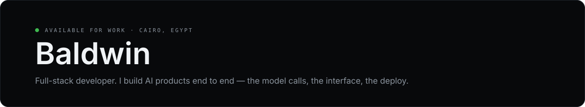

  

## About

Full-stack developer in Cairo. I build AI products end to end — the model calls,
the interface, the deploy. Most of what I ship is for Arabic-speaking users,
since most AI tools still aren't built for them.

I like software that runs on your machine, works without an account, and still
does something useful when the internet drops.

## Projects

| Project | What it does | Built with |
| :------ | :----------- | :--------- |
| **[Aqdi](https://github.com/revolover00/Aqdi)** | Contract generator that runs offline: fill it in, sign it, export a PDF. Nothing leaves the laptop. | Next.js · TypeScript |
| **[Revo ESAI](https://github.com/revolover00/revo-esai1)** | Study assistant for Arabic-speaking students. Live on Vercel. | React · Gemini |
| **[Pro Media](https://github.com/revolover00/Baldwin-edit-all)** | Desktop tool for PDFs and spreadsheets — OCR, text extraction, cleanup. | Python · OCR |
| **[API Tester](https://github.com/revolover00/revo-api-tester)** | A Postman replacement that runs in a browser tab. | React · TypeScript |

Older experiments and half-finished ideas are in [all repositories](https://github.com/revolover00?tab=repositories).

## Stack

**Frontend** — React, Next.js, TypeScript, Tailwind CSS
**Backend** — Node.js, Python, PostgreSQL, Supabase
**AI** — Gemini, OpenAI, OCR pipelines
**Infra & tools** — Vercel, Docker, Git, Figma

## Elsewhere

[GitHub](https://github.com/revolover00) · [Revo ESAI (live)](https://revo-esai.vercel.app) · [Email](mailto:revolover00@gmail.com)

Open to freelance and contract work — email is the fastest way to reach me.
