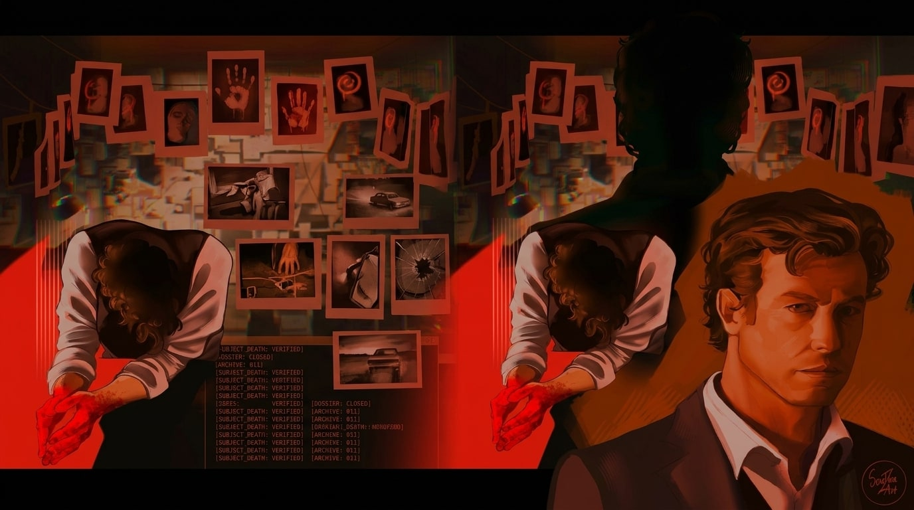
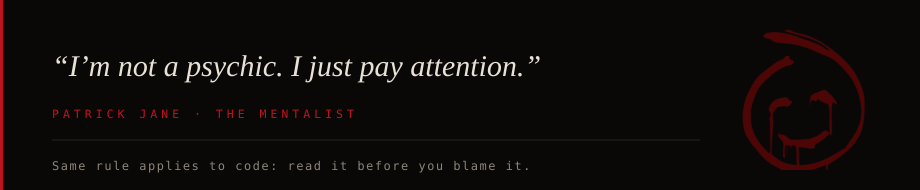
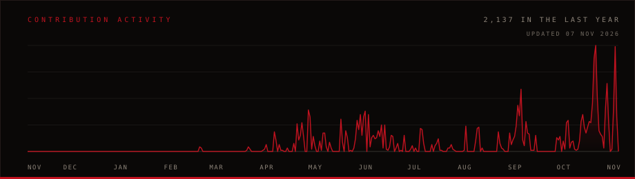
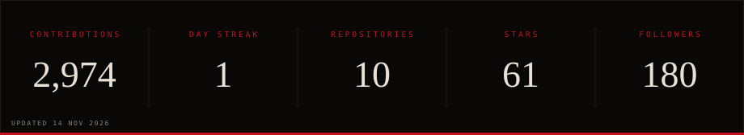

<!-- ─────────────────────────────────────────────────────────────
     BANNER — to use your own image: upload it as assets/banner.jpg
     (any wide image, ~1400-1600px). The filename is all that matters.
     ───────────────────────────────────────────────────────────── -->

  

 

  

**Full-stack developer, based in Cairo.** I build AI products end to end — the model calls, the interface, the deploy.

Most of what I ship is for Arabic-speaking users, because most AI tools still aren't built for them.

I like software that runs on your machine, works without an account, and keeps working when the internet doesn't. If it needs a manual, it isn't finished.

 

 

 

  

  

  

  

  

  

 

  

&nbsp;

  

 

© Baldwin · Cairo, Egypt

