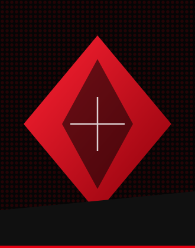
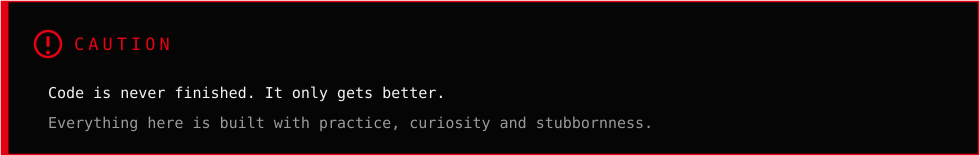

  

  
  
  

  

  <b>Full-stack developer, based in Cairo.</b> I build AI products end to end — the model calls,
  the interface, the deploy.

  Most of what I ship is for Arabic-speaking users, because most AI tools still aren't
  built for them.

  I like software that runs on your machine, works without an account, and keeps working
  when the internet doesn't.

 

YOU CAN CLICK HERE

  

 

 

  

  

  

  

  

  
  

 

 

© Baldwin · Cairo, Egypt

