

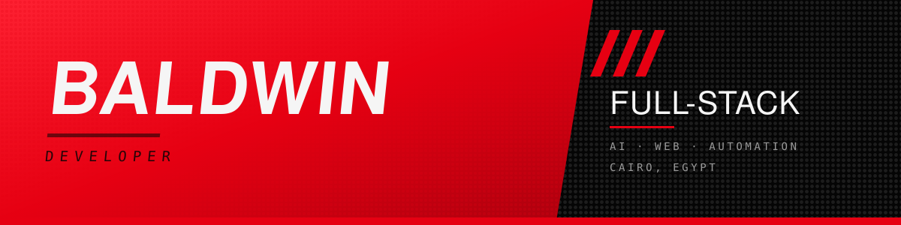

 

<picture>
  <source media="(prefers-color-scheme: dark)" srcset="https://readme-typing-svg.demolab.com?font=JetBrains+Mono&weight=500&size=15&duration=2800&pause=900&color=22E6FF&background=00000000&center=true&vCenter=true&width=620&height=32&lines=Full-Stack+Developer+%C2%B7+Revo+Code;React+%2B+TypeScript+%2B+Next.js+%2B+Gemini+AI;Building+AI+tools+from+Cairo%2C+Egypt;Idea+%E2%86%92+live+app%2C+stupidly+fast">
  
</picture>

 

&nbsp;

&nbsp;

 


<picture>
  <source media="(prefers-color-scheme: dark)" srcset="assets/header-01-dark.svg">
  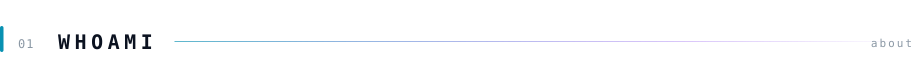
</picture>

I'm **Baldwin** — a full-stack developer from Cairo building AI-powered products that actually ship.

By day I turn caffeine into React components. By night I let Gemini do the heavy lifting while I pretend to understand what it's doing. In between, I generate contracts nobody asked for, OCR documents that don't need it, and push to Vercel at 3 a.m. 🇪🇬

<picture>
  <source media="(prefers-color-scheme: dark)" srcset="assets/terminal-dark.svg">
  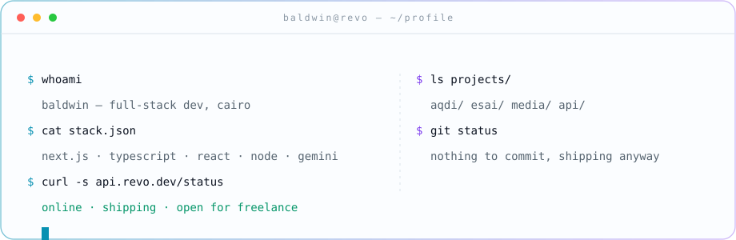
</picture>

 

<picture>
  <source media="(prefers-color-scheme: dark)" srcset="assets/header-02-dark.svg">
  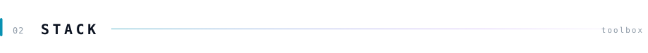
</picture>

**Frontend**

**Backend & Infra**

**AI & Data**

**Tooling**

 

<picture>
  <source media="(prefers-color-scheme: dark)" srcset="assets/header-03-dark.svg">
  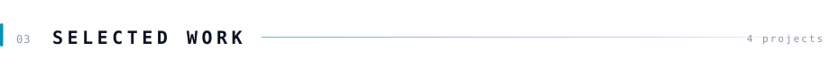
</picture>

<a href="https://github.com/revolover00/Aqdi">
<picture>
  <source media="(prefers-color-scheme: dark)" srcset="assets/proj-aqdi-dark.svg">
  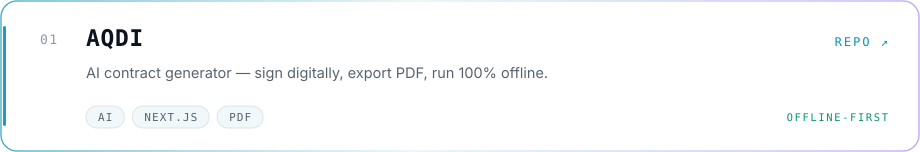
</picture>
</a>

<a href="https://github.com/revolover00/revo-esai1">
<picture>
  <source media="(prefers-color-scheme: dark)" srcset="assets/proj-esai-dark.svg">
  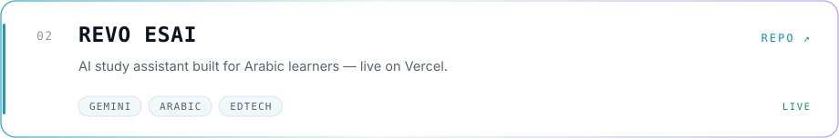
</picture>
</a>

<a href="https://github.com/revolover00/Baldwin-edit-all">
<picture>
  <source media="(prefers-color-scheme: dark)" srcset="assets/proj-media-dark.svg">
  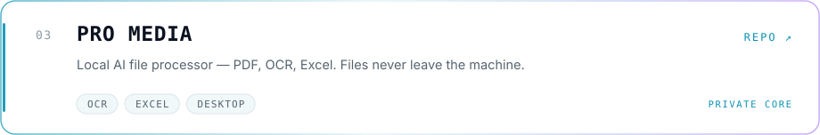
</picture>
</a>

<a href="https://github.com/revolover00/revo-api-tester">
<picture>
  <source media="(prefers-color-scheme: dark)" srcset="assets/proj-api-dark.svg">
  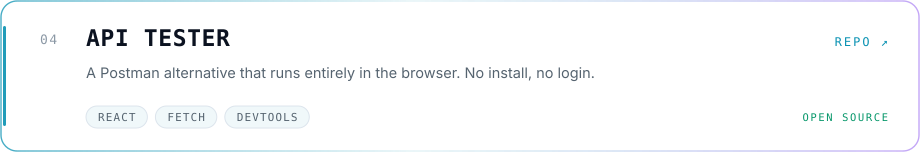
</picture>
</a>

→ or browse <a href="https://github.com/revolover00?tab=repositories">everything else</a> (some of it even works)

 

<picture>
  <source media="(prefers-color-scheme: dark)" srcset="assets/header-04-dark.svg">
  
</picture>

<picture>
  <source media="(prefers-color-scheme: dark)" srcset="assets/services-dark.svg">
  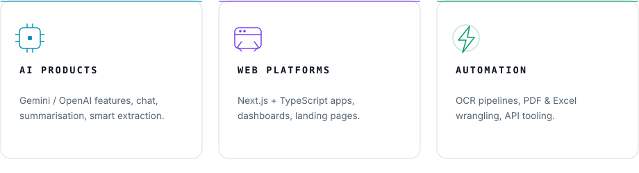
</picture>

**Available for freelance** — AI features, internal tools, document automation, MVPs. You bring the idea, I ship it. If it's weird and nobody's built it yet, that's usually my favourite kind.

 

<picture>
  <source media="(prefers-color-scheme: dark)" srcset="assets/header-05-dark.svg">
  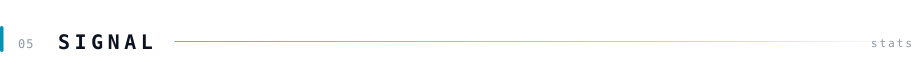
</picture>

  

  

 

<picture>
  <source media="(prefers-color-scheme: dark)" srcset="assets/header-06-dark.svg">
  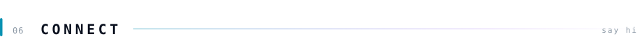
</picture>

  

*"Code is never finished. It only becomes slightly less broken over time."*

*Every commit is a small, desperate apology to my future self.*

 

**BALDWIN · REVO CODE · CAIRO, EGYPT 🇪🇬**

